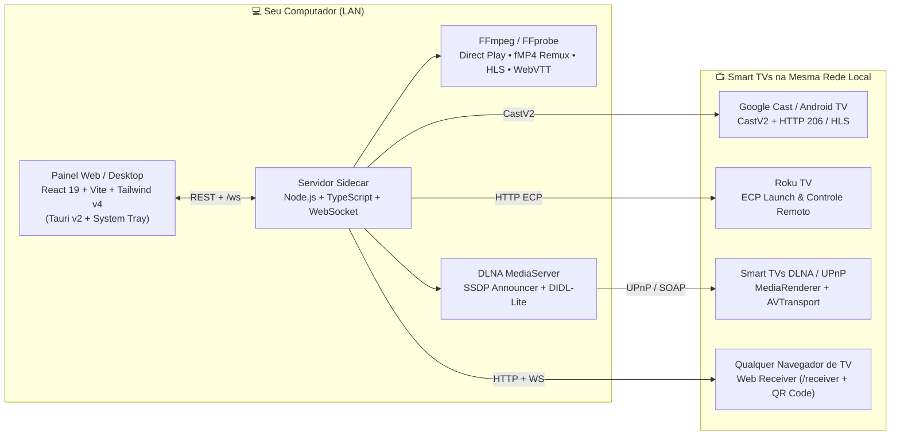

<div align="center">


# Stream to My TV

**Servidor de streaming de vídeo 100% local (LAN-only) do seu PC direto para a sua Smart TV.**  
*Direct Play HTTP 206 • Remux/HLS em tempo real com FFmpeg • Legendas WebVTT • DLNA • Google Cast • Roku ECP • Web Receiver • App Desktop Tauri v2*

<p>
  
  
  
  
  
  
</p>

<p>
  <a href="#-recursos-principais">Recursos</a> •
  <a href="#-arquitetura">Arquitetura</a> •
  <a href="#-início-rápido">Início Rápido</a> •
  <a href="#-protocolos-e-smart-tvs">Protocolos & TVs</a> •
  <a href="#-opções-de-cli-e-variáveis">CLI</a> •
  <a href="#-referência-da-api">API</a> •
  <a href="#-testes-e-verificação">Testes</a>
</p>

</div>

---

> [!IMPORTANT]
> **Privacidade por padrão (Strict LAN-Only):** todo o tráfego de mídia, descoberta de TVs, WebSockets e legendas permanece estritamente dentro da sua rede local — sem nuvem, sem contas e sem upload externo.

## ✨ Recursos Principais

| Categoria | O que está incluído |
| :--- | :--- |
| 🎬 **Reprodução Inteligente** | **Direct Play (HTTP 206 Range)** para arquivos compatíveis e **Remux fMP4 / HLS VOD em tempo real** via FFmpeg (`-c:v copy -c:a aac`), preservando a qualidade original do vídeo sem re-encode pesado. |
| 💬 **Legendas & Faixas** | Suporte a legendas embutidas (`SRT`, `ASS/SSA`, `WebVTT`, `mov_text`) e **upload instantâneo** de arquivos de legenda convertidos para `WebVTT`, além de seleção de faixas de áudio. |
| 📡 **Descoberta Automática na LAN** | Escaneamento automático de Smart TVs na sub-rede local via **SSDP / UPnP**, **mDNS / Bonjour**, **Google Cast (`_googlecast._tcp`)**, **Roku ECP** e **AirPlay (`_airplay._tcp`)**. |
| 📺 **Múltiplos Modos de Envio** | **Google Cast (CastV2)**, **DLNA MediaServer** (anúncio SSDP + `ContentDirectory` + push `AVTransport`), **Roku ECP** (launch & controle remoto) e **Web Receiver** (`/receiver`) acessível por QR Code em qualquer navegador de TV. |
| 🕹️ **Controle em Tempo Real** | Sincronização bidirecional via **WebSocket (`/ws`)** para play, pause, seek, volume, troca de áudio e legendas com fila de seek resiliente. |
| 🖥️ **App Desktop Nativo (Tauri v2)** | Empacotamento desktop com **bandeja do sistema (*minimize-to-tray*)** para manter a transmissão ativa em segundo plano e supervisão de ciclo de vida do sidecar Node.js + FFmpeg sem processos órfãos. |

---

## 🏗️ Arquitetura



### Estrutura do Projeto

```text
stream-to-my-tv/
├── src/                  # Backend Node.js + TypeScript (HTTP 206, FFmpeg, DLNA, Cast, Roku, WS)
│   └── ui/               # Web Receiver, controle remoto e fila de seek
├── frontend/             # Painel SPA moderno (React 19, Vite, Tailwind CSS v4, TanStack Query, Zod)
├── src-tauri/            # Host Desktop nativo em Rust (Tauri v2, System Tray, SidecarSupervisor)
├── scripts/              # Build do sidecar, benchmark, E2E e launcher desktop (.ps1)
├── test/                 # Suíte de testes do servidor, fila de seek e ciclo de vida do sidecar
├── assets/               # Ícones e identidade visual
└── Stream to My TV.cmd   # Atalho rápido no Windows para iniciar o servidor + janela do app
```

---

## 🚀 Início Rápido

### Pré-requisitos

- **Node.js 22+** (com `npm`)
- **pnpm** (para o painel em `frontend/`)
- **Rust / Cargo** *(opcional — apenas se quiser compilar o binário nativo Tauri v2)*
- *FFmpeg e FFprobe já são resolvidos automaticamente via `ffmpeg-static` e `ffprobe-static`.*

### 1. Instalar dependências

```bash
# Dependências do servidor de streaming
npm install

# Dependências do painel web (React + Vite)
pnpm --dir frontend install
```

### 2. Executar o servidor

```bash
# Modo padrão (LAN + localhost na porta 4321)
npm start

# Ou passando uma pasta específica de vídeos
npx tsx src/index.ts "C:\Users\Voce\Videos"
```

### 3. Modo Desktop no Windows

Você pode dar um duplo clique em **`Stream to My TV.cmd`** ou executar:

```bash
npm run desktop
```

O script compila automaticamente o bundle do sidecar e o frontend (se necessário), inicia o servidor em segundo plano e abre o painel em janela dedicada de aplicativo.

> [!TIP]
> Ao iniciar, o servidor exibe no terminal os endereços prontos para uso na sua rede:
> - **Painel Web:** `http://<seu-ip-lan>:4321/`
> - **Web Receiver (TV):** `http://<seu-ip-lan>:4321/receiver`
> - **QR Code SVG:** `http://<seu-ip-lan>:4321/api/network/qr.svg`
> - **DLNA Device XML:** `http://<seu-ip-lan>:4321/dlna/device.xml`

---

## 📺 Protocolos e Smart TVs

| Dispositivo / Protocolo | Formatos & Recursos | Observações |
| :--- | :--- | :--- |
| **Google Cast / Chromecast / Android TV** | MP4 (H.264/HEVC Direct Play HTTP 206), fMP4 Remux, HLS VOD e legendas `WebVTT` via CastV2 | Controle completo de reprodução, volume e seek |
| **Roku TV** | MP4 (H.264/AAC), HLS Remux, MKV, `WebVTT` / `SRT` + controle remoto ECP | Requer acesso de rede *Permissivo* nas configurações da Roku |
| **Smart TVs DLNA / UPnP** | `MediaServer:1` com anúncio SSDP automático, `ContentDirectory` e push `AVTransport` | Compatível com TVs Samsung, LG, Sony, Philips e players DLNA |
| **Web Receiver (`/receiver`)** | Player HTML5 completo controlado via WebSocket | Ideal para qualquer TV com navegador — basta escanear o QR Code |

**Formatos de mídia escaneados:** `.mp4`, `.mkv`, `.webm`, `.mov` e `.avi`.

> [!NOTE]
> **Dica para TVs Roku:** se a TV estiver em modo *Limited*, ative em:  
> `Configurações → Sistema → Configurações avançadas do sistema → Controle por aplicativos móveis → Acesso à rede → Permissivo`.

---

## ⚙️ Opções de CLI e Variáveis

```bash
npx tsx src/index.ts [opções] [caminhos-de-midia...]
```

| Flag CLI | Variável de Ambiente | Descrição | Padrão |
| :--- | :--- | :--- | :--- |
| `--port <n>` | `PORT` | Porta HTTP/WebSocket do servidor | `4321` |
| `--ip <ipv4>` | `LAN_IP` | IPv4 explícito da interface LAN | Auto-detectado |
| `--bind <host>` | `BIND_HOST` | Endereço de bind do servidor | `0.0.0.0` |
| `--strict` / `--no-loopback` | `ALLOW_LOOPBACK=false` | Restringe estritamente à sub-rede LAN (desativa `localhost`) | `allowLoopback=true` |
| `--allowed-root <dir>` | `ALLOWED_SCAN_ROOTS` | Restringe diretórios permitidos para escaneamento | Livre |
| `--frontend-dist <dir>` | `FRONTEND_DIST_DIR` | Diretório compilado do painel React | `frontend/dist` |
| `--ffmpeg-path <bin>` | `FFMPEG_PATH` | Binário customizado do FFmpeg | `ffmpeg-static` |
| `--ffprobe-path <bin>` | `FFPROBE_PATH` | Binário customizado do FFprobe | `ffprobe-static` |
| `--watch-stdin` | `TAURI_SIDECAR=1` | Encerra graciosamente quando o processo pai fecha `stdin` | `false` |

---

## 🔌 Referência da API

<details>
<summary><strong>Clique para expandir os endpoints HTTP, Streaming, DLNA e WebSocket</strong></summary>

### Rede & Status
- `GET /api/status` — Saúde e estado geral do servidor
- `GET /api/network` — Interface LAN ativa, URLs e metadados de conexão
- `GET /api/network/qr.svg` — QR Code SVG para pareamento rápido da TV

### Biblioteca & Legendas
- `GET /api/library` — Lista mídias indexadas com faixas de vídeo, áudio e legenda
- `POST /api/library/scan` — Escaneia um diretório local de mídia
- `POST /api/library/refresh` — Reindexa as pastas configuradas
- `POST /api/media/:id/subtitles/upload` — Faz upload de legenda externa (`.srt`/`.vtt`)

### Sessão, Descoberta & Controle de TVs
- `GET /api/session` / `POST /api/session` — Estado atual da sessão de reprodução
- `GET /api/tvs` / `POST /api/tvs/scan` — Lista e descobre Smart TVs na LAN
- `POST /api/tv/cast/load` / `POST /api/tv/cast/control` — Envio e controle via Google Cast
- `POST /api/tv/roku/launch` / `POST /api/tv/roku/keypress` — Envio e controle remoto Roku ECP
- `POST /api/tv/dlna/push` — Push direto para renderizadores DLNA/UPnP
- `WS /ws` — Canal em tempo real para sincronização do painel e do Web Receiver

### Mídia & DLNA
- `GET /stream/:id` — Endpoint unificado de streaming
- `GET /media/:id/direct.mp4` — Direct Play com suporte a `HTTP 206 Partial Content`
- `GET /media/:id/remux.mp4` — Remux em tempo real (`fMP4`) via FFmpeg
- `GET /media/:id/hls/master.m3u8` & `seg_*.ts` — Playlist e segmentos HLS VOD
- `GET /subtitles/:id/:track` — Entrega de legendas em formato `WebVTT`
- `GET /dlna/device.xml` — Descrição UPnP `MediaServer:1` (`ContentDirectory` + `ConnectionManager`)

</details>

---

## 🧪 Testes e Verificação

```bash
# Backend: typecheck + testes unitários e de ciclo de vida
npm run typecheck
npm test

# Verificação End-to-End completa
npm run verify

# Frontend: lint, typecheck e testes (Vitest + Testing Library + MSW)
pnpm --dir frontend lint
pnpm --dir frontend typecheck
pnpm --dir frontend test

# Host Desktop Tauri v2 (Rust)
cargo test --manifest-path src-tauri/Cargo.toml
```

---

<div align="center">

Feito para assistir seus vídeos locais na tela grande, sem complicação e sem sair da sua rede. 🍿

</div>
